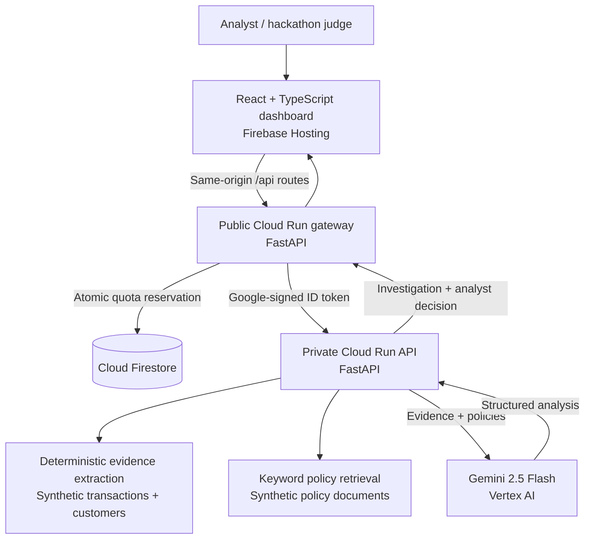

# FinGuard AI

### From fraud alerts to evidence-backed investigations — with a human in control.

**Team:** TrustForge  
**Event:** Google Cloud AI Builder Cup 2026  
**Live demo:** https://trustforge-finguard-ai-2026.web.app  
**Submitted source:** [`main`](https://github.com/vaishali-mahajan-design/trustforge-finguard-ai/tree/main)  
**Demo video:** https://youtu.be/v29rVu1xjx4

## What is FinGuard AI?

FinGuard AI is a **human-in-the-loop fraud investigation copilot** that helps analysts turn raw transaction alerts into structured, evidence-backed reviews. Instead of asking a language model to guess whether an alert is fraudulent, the system first computes deterministic signals from synthetic customer and transaction data, retrieves relevant policy excerpts, and then uses **Gemini 2.5 Flash on Google Cloud Vertex AI** to compare competing explanations, highlight missing evidence, and recommend a next action.

**The analyst makes the final decision.** FinGuard AI does not approve, block, or execute financial transactions.

## Try the live demo

Open **https://trustforge-finguard-ai-2026.web.app**.

1. Select **FG-1042** to investigate possible account takeover involving a new device, a new beneficiary, unusual activity, and a blocked transfer attempt.
2. Review the deterministic evidence, primary and alternative hypotheses, policy basis, counterfactual, and suggested next step. Open **Case graph** to explore linked transactions, entities, evidence, and policies.
3. Record a human decision — **CLEAR**, **REQUEST_VERIFICATION**, or **ESCALATE** — with a rationale.
4. Select **FG-1007** to compare a potentially legitimate international transaction supported by travel context.
5. Optionally download an investigation report as JSON.

> **Demo availability:** The public gateway enforces a shared quota of **24 investigation attempts total** and **4 per minute** to limit billable Gemini usage. If the quota is exhausted, contact the team for a guided demonstration. Investigation calls consume quota even when the downstream request fails.

## Why this approach?

- **Evidence before inference:** Amount anomaly, device change, geography, velocity, beneficiary changes, international history, and travel context are derived from case data rather than invented by the model.
- **Grounded explanations:** Gemini receives the computed evidence and retrieved policy excerpts, and must cite supplied evidence and policy IDs. The backend validates referenced IDs; an analyst must still review narrative accuracy.
- **Competing hypotheses:** The output includes a primary explanation, an alternative explanation, contradictory or missing evidence, and a counterfactual.
- **Interactive Case Evidence Map:** The graph connects the alert, customer, transactions, devices, beneficiaries, evidence, and policy matches, with zoom and full-screen exploration.
- **Human accountability:** Recommendations are advisory; the analyst explicitly selects an action and records a rationale.
- **Controlled public demo:** A quota-limited gateway invokes a private Cloud Run backend. Only two synthetic case IDs are exposed.

## Architecture



**Google Cloud services:** Vertex AI (Gemini 2.5 Flash), Cloud Run (private investigation API and public gateway), Firestore (durable gateway quota), Firebase Hosting (React application), Cloud Build / Artifact Registry (container deployment).

**Application stack:** Python 3.12, FastAPI, Pydantic, Google Gen AI SDK, React, TypeScript, Vite.

## Two synthetic investigation scenarios

| Case | Context | What the analyst evaluates |
| --- | --- | --- |
| **FG-1042 — Potential account takeover** | Singapore activity on a new Android device; new beneficiary; unusual transaction velocity. Two **approved** transfers of ₹49,000 and ₹76,000 total ₹125,000. A **separate ₹125,000 attempt was blocked**. | Multiple independent risk signals, alternative legitimate-travel explanation, and trusted-channel verification or escalation. |
| **FG-1007 — Potential false positive** | ₹42,000 approved international purchase during a declared Singapore trip, with prior international activity. | Whether travel context and history reasonably explain the geographic deviation, while considering missing authentication evidence. |

These are **fabricated demonstration cases**, not real banking records. The model's recommended action can vary between runs; the human decision remains authoritative.

## Repository structure

```text
.
├── backend/
│   ├── app/                  # API, evidence extraction, policy retrieval, Gemini, demo guard
│   ├── data/                 # Synthetic alerts, customer profiles and policy excerpts
│   ├── tests/                # API and evidence tests
│   └── Dockerfile
├── frontend/
│   └── src/                  # React analyst dashboard and API client
├── gateway/
│   ├── app.py                # Public allowlisted proxy + Firestore quota
│   └── Dockerfile
├── firebase.json            # Hosting and Cloud Run gateway rewrites
└── .firebaserc
```

## Run locally

**Backend (mock mode, no cloud credentials required):**

```bash
cd backend
python3 -m venv .venv
source .venv/bin/activate
pip install -r requirements.txt
cp .env.example .env
python -m uvicorn app.main:app --reload --port 8080
```

**Frontend (in a second terminal):**

```bash
cd frontend
npm install
printf 'VITE_API_BASE_URL=http://127.0.0.1:8080\n' > .env.development.local
npm run dev
```

Open `http://127.0.0.1:5173`. API documentation is available at `http://127.0.0.1:8080/docs`.

To use **real Vertex AI locally**, configure Application Default Credentials, set `MOCK_GEMINI=false`, and set `GOOGLE_CLOUD_PROJECT`, `GOOGLE_CLOUD_LOCATION=global`, and `GEMINI_MODEL=gemini-2.5-flash` in `backend/.env`. Do not commit credentials or local `.env` files.

**Run deterministic tests:**

```bash
cd backend
MOCK_GEMINI=true python -m pytest -q
```

**Build the production frontend:**

```bash
cd frontend
npm run build
```

The production `VITE_API_BASE_URL` is empty so the browser uses same-origin Firebase Hosting routes. Do not place service-account credentials or Google Cloud identity tokens in any `VITE_` variable.

## API overview

- `GET /health` — service health and Gemini mode
- `GET /api/v1/alerts` — synthetic alert queue
- `GET /api/v1/alerts/{alert_id}` — alert details
- `POST /api/v1/investigations/{alert_id}` — run evidence extraction and Gemini analysis
- `GET /api/v1/investigations/{investigation_id}` — retrieve an investigation in the active backend instance
- `POST /api/v1/investigations/{investigation_id}/decision` — record a human decision

The public gateway allowlists only the two demo alert IDs and checks a Firestore-backed quota before forwarding an investigation request.

## Deployment and access model

- **Firebase Hosting:** https://trustforge-finguard-ai-2026.web.app
- **Public gateway:** Cloud Run service `finguard-gateway`, region `asia-south1`. It runs as a dedicated service account with Firestore access and `roles/run.invoker` on the private API.
- **Private backend:** Cloud Run service `finguard-api`, region `asia-south1`. **Unauthenticated access is disabled**. Its runtime identity can invoke Vertex AI.
- **Firestore:** `(default)` database in `asia-south1`, used for atomic gateway quota reservations.

**Do not make `finguard-api` public.** The gateway is intentionally the only public API entry point. A billing budget alert is recommended; neither Firestore quotas nor Cloud Run max-instance settings constitute a hard spending cap.

## Safety and prototype limitations

- All customer, transaction, and policy data is synthetic; no live banking systems are connected.
- Policy retrieval is keyword-based over local policy excerpts, **not vector-search RAG**.
- Evidence IDs and policy IDs are checked, but generative narrative can still contain unsupported interpretations; analyst review is required.
- Investigation and analyst-decision records are held **in backend memory** and can be lost on restart or across instances. Firestore currently persists **gateway quota state only**, not case decisions.
- Dashboard counters are session-local and should not be interpreted as organization-wide fraud metrics.
- The gateway is publicly accessible and unauthenticated. Its global quota limits model invocations but can be exhausted by other visitors. It is a hackathon demo, not a production authentication or abuse-prevention solution.
- No AI-generated recommendation automatically takes action on a transaction.

## Next steps beyond the prototype

Persist investigation/decision audit trails; add analyst authentication and role-based access; integrate approved transaction and identity data sources; improve evidence-level factual validation; add observability and evaluation datasets; and replace simple policy matching with permission-aware retrieval.

---

**Built by TrustForge for the Google Cloud AI Builder Cup 2026.**  
Vaishali Mahajan — Project Lead & Developer · Amruta Sandela — Team Member.
